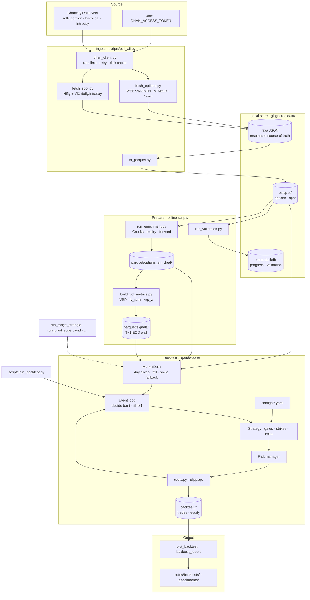

# DhanApiBacktest

[](https://github.com/suraj9321/DhanApiBacktest/actions/workflows/tests.yml)


> An end-to-end quantitative research stack for **systematic Nifty option-selling**:
> a resumable data pipeline, volatility modeling, and a **no-lookahead, event-driven
> backtester** built on 5 years of historical option-chain data from the
> [DhanHQ API](https://dhanhq.co/docs/v2/).

The strategy under research: hedged premium selling (iron condors / flies) on Nifty weekly
and monthly expiries, entered only when the variance risk premium — implied volatility minus
forecast realized volatility — is statistically wide. Full strategy documentation lives in
the Obsidian vault under [`notes/`](notes/Home.md) (open `notes/` as a vault in Obsidian;
start at `Home.md`).

**Results are reported honestly.** Most tested edges did not survive realistic transaction
costs; one hedged weekly variant is net-positive but not yet walk-forward validated. The
deliverable is the *methodology and infrastructure* — not a cherry-picked return.


### What this project demonstrates

- **Event-driven backtesting** — a chronological minute-bar event loop with a strict
  anti-look-ahead wall: decisions use only data available at bar *t* (signals gated to a
  T−1 EOD cutoff), fills happen at *t+1*. Invariants are asserted at the end of every run.
- **Options & volatility modeling** — Black–Scholes Greeks enrichment, a variance-risk-premium
  signal library (IV vs. GARCH-forecast realized vol via the `arch` library), IV rank and
  z-scores — all with a no-lookahead derivation wall.
- **Data engineering** — resumable, idempotent API ingestion (raw-response disk cache as
  source of truth), partitioned columnar **Parquet** sorted for predicate pruning, and
  **DuckDB** querying the store in place with no import step.
- **Realism & testing** — a single-source transaction-cost model (brokerage, STT, exchange
  fees, GST, slippage) that every fill passes through, with per-trade cost attribution in the
  ledger; a **data-free `pytest` suite** that verifies the money math on a fresh clone.
- **Reproducible reporting** — self-contained, theme-aware interactive HTML dashboards
  generated straight from the trade ledgers.

### Tech stack

Python 3.12+ · pandas · pyarrow / Parquet · DuckDB · scipy · arch (GARCH) · PyYAML ·
pytest · GitHub Actions

### Reproducibility

The **test suite runs on a fresh clone with no data**:

```bash
pip install -r requirements.txt && pip install pytest && pytest tests/ -q
```

The full 5-year option history requires a paid DhanHQ **Data APIs** subscription and is
gitignored (too large for git, regenerable via `scripts/pull_all.py`). Committed charts
under [`notes/attachments/`](notes/attachments/) are the evidence of past runs, and the
full research narrative lives in the [`notes/`](notes/Home.md) vault.

## Repository layout

```
notes/               Obsidian vault: strategy, risk framework, decisions, references
src/pipeline/        Data pipeline package
  config.py            All tunables (IDs, windows, strike grid, rate limits, paths)
  dhan_client.py       Throttled HTTP client with retry + raw-response disk cache
  fetch_options.py     5y rolling expired-options pull (WEEK+MONTH, ATM±10, 1-min bars)
  fetch_spot.py        Nifty + India VIX: daily since inception, 1-min intraday 5y
  to_parquet.py        Raw JSON → partitioned Parquet
scripts/pull_all.py  Pipeline orchestrator CLI
data/                (gitignored) raw JSON cache, Parquet store, meta.duckdb
```

## Architecture

End-to-end flow: pull historical chains and index series from Dhan, cache raw responses,
materialize columnar stores, derive Greeks and volatility signals (with a strict no-lookahead
wall), then run YAML-configured strategies through a minute-bar event loop. Deeper design
notes: [`notes/data-pipeline.md`](notes/data-pipeline.md),
[`notes/architecture-backtester.md`](notes/architecture-backtester.md).



Specialized strategy scripts (range strangle, pivot/Supertrend, expiry-day grids) reuse
`MarketData` and `costs.py` but bypass the main condor/fly engine where the trade shape
differs.

## Obsidian vault — shared research brain

The `notes/` folder is a full **Obsidian vault** checked into git alongside the code. It
holds the *why* behind the pipeline: thesis, measured facts, design specs, dead ends, and
dated decisions. Parquet answers “what happened”; the vault answers “what we believed, what
we tried, and what we learned.”

**Open it:** In Obsidian → *Open folder as vault* → select `notes/`. Start at
[`Home.md`](notes/Home.md) (map of content with `[[wikilinks]]` to every major topic).

| Layer | Examples | Role |
|-------|----------|------|
| Mandate & risk | [`strategy-overview`](notes/strategy-overview.md), [`risk-framework`](notes/risk-framework.md) | Non-negotiables (hedged structures, loss layers, cost model) |
| Signals & mechanics | [`vrp-signals`](notes/vrp-signals.md), [`vol-metrics`](notes/vol-metrics.md), [`adjustment-policy`](notes/adjustment-policy.md) | What entry/exit rules *mean* and how they were derived |
| Infrastructure | [`data-pipeline`](notes/data-pipeline.md), [`architecture-backtester`](notes/architecture-backtester.md) | Specs the Python code is meant to implement |
| Evidence | [`analysis-monday-entry`](notes/analysis-monday-entry.md), [`validation-report`](notes/validation-report.md), `analysis-*` | Charts and statistics that predate or justify configs |
| Run log | [`backtests/`](notes/backtests/) | One note per backtest: numbers *plus* diagnosis (e.g. VRP-z inversion) |
| Memory | [`decisions-log`](notes/decisions-log.md), [`conversation-log`](notes/conversation-log.md) | Dated choices and context so nothing is re-litigated from scratch |
| Figures | [`attachments/`](notes/attachments/) | PNGs embedded in notes (`![[…]]`) and linked from this README |

Notes cross-link freely (`[[run-2026-07-18-fly-series]]` → fly configs, →
`[[vrp-signals]]`). In Obsidian’s graph view that becomes a **domain graph**—strategy,
data limits, and results stay wired together as the project grows.

### Using the vault with coding agents (e.g. Cursor)

Treat `notes/` as a **custom brain** you attach to automation:

1. **Context at prompt time** — `@notes/Home.md` or `@notes/backtests/` when asking for a
   new variant, a pipeline fix, or a README update; the agent inherits mandate and past
   failures instead of guessing.
2. **Rules** — A project rule such as “read `notes/risk-framework.md` before changing
   sizing or naked legs” keeps codegen aligned with documented constraints.
3. **Close the loop** — After a meaningful run or decision, add or update a note (especially
   under `backtests/` and `decisions-log.md`). Future sessions—and future you—get continuity
   without re-explaining the ATM±10 wing gap or the z-band gate story.
4. **Planned `journal/`** — One note per live/paper week (see `Home.md`); same pattern as
   backtest logs, for the execution phase on the roadmap.

Machine-local Obsidian UI state (`notes/.obsidian/workspace.json`) is gitignored; vault
**content** is meant to be shared. **Never** put API tokens or account details in notes—only
in `.env`.

**Agent skills:** This repo ships an agent skill describing the workflow, hard constraints,
and post-run logging — for both [Cursor](.cursor/skills/dhan-nifty-backtest/SKILL.md)
(`@dhan-nifty-backtest`) and [Claude Code](.claude/skills/dhan-nifty-backtest/SKILL.md)
(`/dhan-nifty-backtest`). Either agent inherits the mandate and past failures instead of
guessing when working on backtests here.

## Setup

```bash
python3 -m venv .venv
.venv/bin/pip install -r requirements.txt
cp .env.example .env   # then fill in DHAN_ACCESS_TOKEN and DHAN_CLIENT_ID
```

Requires an active DhanHQ **Data APIs** subscription. The token lives only in `.env`
(gitignored) — never commit it, never put it in `notes/`.

## Usage

```bash
.venv/bin/python scripts/pull_all.py --probe    # ~4 tiny calls: verify token, IDs, response shapes
.venv/bin/python scripts/pull_all.py --options  # 5y options pull (resumable; ~30-60 min)
.venv/bin/python scripts/pull_all.py --spot     # index daily + intraday history
.venv/bin/python scripts/pull_all.py --parquet  # rebuild Parquet from raw cache (offline)
.venv/bin/python scripts/pull_all.py --status   # inventory of cache + Parquet (offline)
.venv/bin/python scripts/pull_all.py --all      # everything, in order
```

Run `--probe` first on a fresh setup and check its output before the full pull: it
empirically resolves two API ambiguities (whether one call returns both CE and PE legs,
and strike-offset semantics) that determine the shape of the full request grid.

All pulls are **resumable and idempotent**: every API response is cached to
`data/raw/` before parsing, keyed by request identity, so interrupted runs continue
where they stopped and completed calls are never repeated.

## Data store

- **Parquet** (`data/parquet/`) — write-once minute bars.
  Options: `options/flag=week|month/month=YYYY-MM/`, rows sorted by
  `(option_type, strike_offset, ts)` so row-group zone maps prune strike and time
  predicates without indexes. Spot: `spot/<instrument>_<daily|intraday>/year=YYYY/`.
- **DuckDB** — query engine over the Parquet in place (no import step), e.g.:

  ```sql
  SELECT ts, close, iv FROM read_parquet('data/parquet/options/flag=week/*/part.parquet')
  WHERE option_type = 'CE' AND strike_offset = 0 ORDER BY ts;
  ```

- `data/meta.duckdb` — mutable bookkeeping (fetch progress, validation results,
  calendars); bulk data never lives here.

Design rationale (columnar OLAP fit, engine decoupling, month-not-expiry partitioning)
is documented in [`notes/data-pipeline.md`](notes/data-pipeline.md).

## Backtest results

Historical runs use **₹8L notional capital**, minute-bar fills with brokerage + slippage
(`src/backtest/costs.py`), and the option history described above. Full write-ups, configs,
and charts live under [`notes/backtests/`](notes/backtests/).

| Strategy | Period | Net return | Sharpe | Max DD | Trades | Win % | Verdict |
|----------|--------|------------|--------|--------|--------|-------|---------|
| Weekly iron condor (`weekly_v01`) | 5y | −3.7% | −0.68 | −5.3% | 202 | 58% | Costs dominate thin 15Δ credit |
| Iron fly, VRP gate only | 5y | −10.7% | −0.34 | −17.0% | 210 | 54% | Unconditional fly ≈ wings eat edge |
| Iron fly, `vrp_z ≥ 0.5` | 5y | −15.0% | −0.69 | −17.5% | 69 | 39% | High-z weeks adverse (inversion) |
| **Iron fly, band gate** (`vrp>0`, `z≤0.5`) | 5y | **+6.7%** | **0.40** | **−4.5%** | 123 | 64% | **Only hedged weekly variant net green** |
| Expiry-day condor (0DTE grid) | 5y | −5% to −17% | &lt; 0 | — | 50–229 | 58–72% | All grid cells negative |
| Range-breakout strangle (naked) | 5y | +1.8% | 0.21 | −3.5% | 102 | 89% | Thin edge; puts only; high skew |
| Pivot + Supertrend ATM (EOD exit) | 1y | +2.6% | 0.35 | −7.6% | 195 | 65% | PF ~1.06; 4/6 full years negative |

### Charts

Committed PNGs live in [`notes/attachments/`](notes/attachments/). Regenerate the
four-panel ledgers with `python scripts/plot_backtest.py <config_name>` after a local
run (reads `data/backtest_<name>_{equity,trades}.parquet`, gitignored).

**Best hedged weekly run — iron fly with z-band gate (`weekly_fly_zband`)**


**Baseline weekly condor (`weekly_v01`) — cost drag vs gross**


**VRP gate inversion (unconditional iron fly, mean P&L by entry-day `vrp_z`)**


**Other variants explored**

| | |
|---|---|
| Range-breakout strangle (naked) | Pivot + Supertrend (EOD, full sample) |
|  |  |

Full interactive pivot dashboard (hover equity curve, weekly/monthly bars, CE vs PE):
[`notes/attachments/backtest-pivot-supertrend-report.html`](notes/attachments/backtest-pivot-supertrend-report.html)
(regenerate with `python scripts/backtest_report.py data/backtest_pivot_supertrend_trades.parquet "…"`).

Self-contained HTML dashboards (KPI hero, equity curve, weekly/monthly P&L, trade analytics)
are generated straight from a trade ledger:

```bash
# main condor/fly engine ledgers (nets per-trade costs, classifies by realized move)
python scripts/report_condor.py data/backtest_<name>_trades.parquet "<Title>"
# alternate-runner (flat) ledgers
python scripts/backtest_report.py data/backtest_<name>_trades.parquet "<Title>"
```

**Takeaways**

- **Best run so far:** z-band-gated weekly iron fly (+6.7% over five years, ~10.6% of
  gross wins lost to costs). The useful gate is a *band* (premium exists but IV is not a
  stress outlier), not “sell when VRP is unusually wide.”
- **Baseline weekly condor** loses mainly to fixed costs on small credits and a twitchy
  delta-breach exit; see [`run-2026-07-18-weekly-v01`](notes/backtests/run-2026-07-18-weekly-v01.md).
- **0DTE condors** and **intraday pivot/Supertrend** selling did not clear costs under
  tested rules; directional naked legs inherit short-gamma payoff without a durable edge.
- **Range strangle** is slightly positive in-sample but naked, margin-proxy sized, and
  driven by put-side index drift; hedged follow-up was blocked by ATM±10 strike coverage
  ([`run-2026-07-20-range-strangle`](notes/backtests/run-2026-07-20-range-strangle.md)).

**Caveats (read before trusting any number):** gate thresholds for the green fly run were
identified on the same sample then re-tested in-sample; **walk-forward validation is the
next required step**. Slippage and margin models are calibrated placeholders until checked
against live books. Options data and P&L for far-from-ATM legs rely more on quote
fallbacks where liquidity thins.

## Roadmap

1. ✅ Data pipeline
2. ✅ Validation (`scripts/run_validation.py` — see `notes/validation-report.md`) and
   Greeks enrichment (`scripts/run_enrichment.py` → `data/parquet/options_enriched/`)
3. ✅ Vol-metrics library (`scripts/build_vol_metrics.py` → `data/parquet/signals/`)
4. ✅ Event-driven backtester (`scripts/run_backtest.py configs/<variant>.yaml`; tests in `tests/`)
5. Strategy grid + walk-forward validation
6. Paper trading against the live option chain, then live with 1–2 lots

## Disclaimer

Private research project, not investment advice. Options selling carries bounded-looking
but real tail risk; every number here is subject to the backtest's assumptions.
