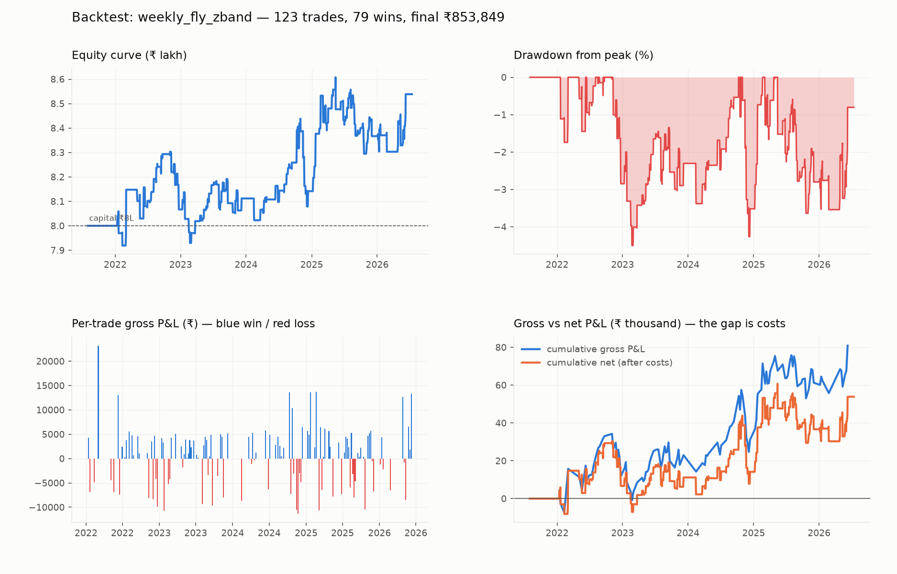
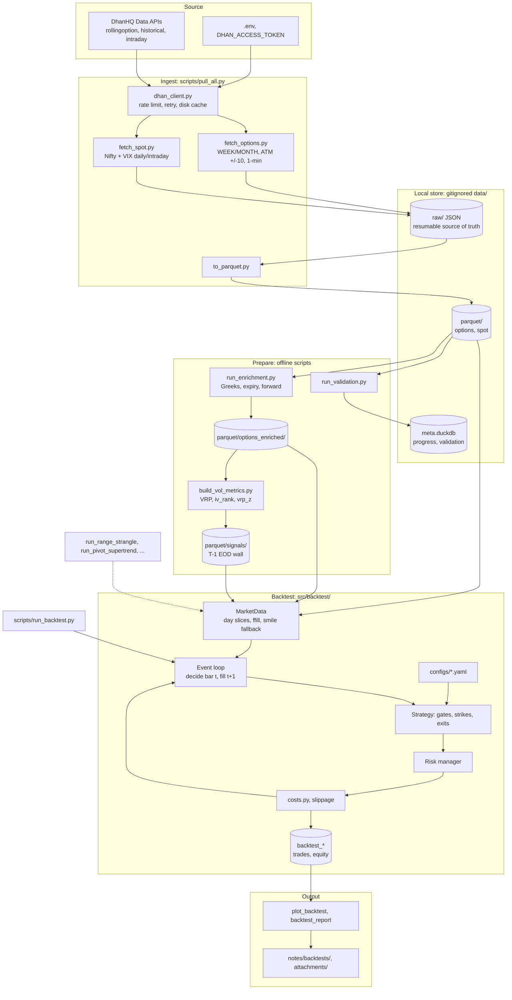
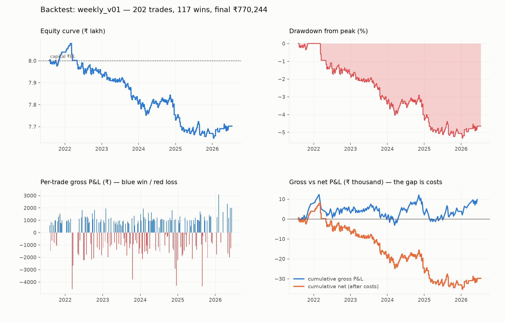
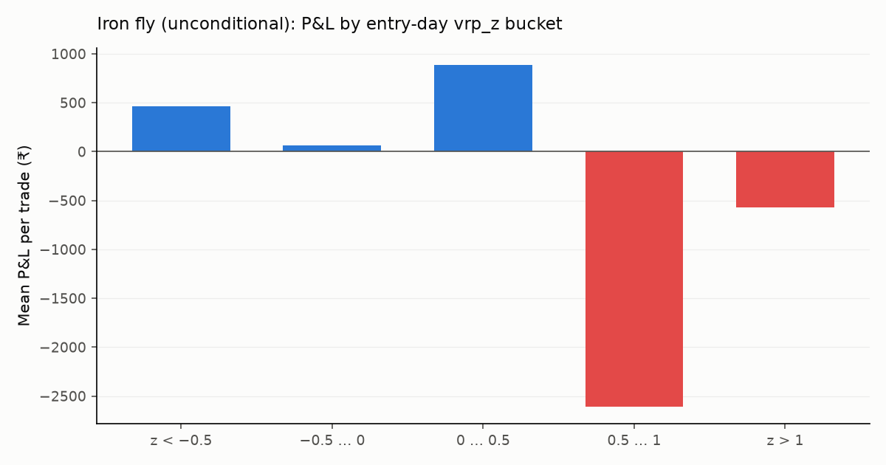
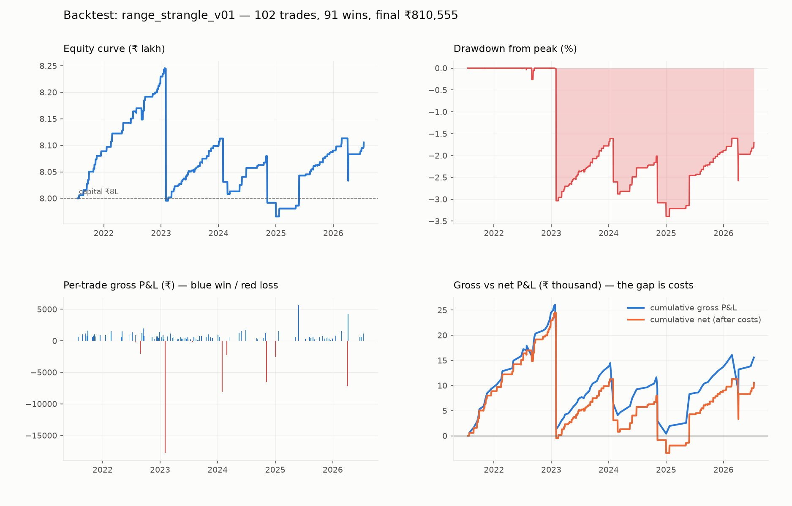
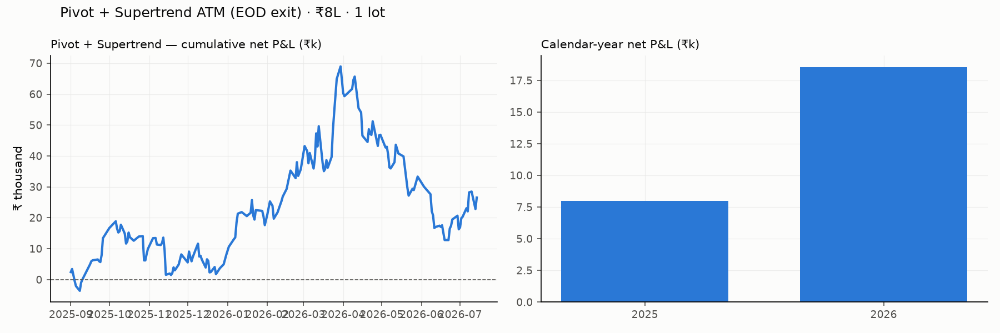

# DhanApiBacktest

[](https://github.com/suraj9321/dhan-api-backtest-options-framework/actions/workflows/tests.yml)


Research code for selling Nifty index options systematically. It covers the whole path:
pulling historical option-chain data from the [DhanHQ API](https://dhanhq.co/docs/v2/),
building a clean columnar data store, deriving Greeks and volatility signals without
lookahead, and running strategies through a minute-bar, event-driven backtester.

The idea under test is hedged premium selling (iron condors and iron flies) on Nifty
weekly and monthly expiries, taken only when the variance risk premium (implied volatility
minus a forecast of realized volatility) is wide enough to be worth it. The longer strategy
write-up lives in the Obsidian vault under [`notes/`](notes/Home.md): open `notes/` as a
vault in Obsidian and start at `Home.md`.

A word on the numbers before you read them: most of the ideas here did not survive realistic
trading costs. One hedged weekly variant comes out net positive, but it has not been
walk-forward validated yet, so treat it as promising rather than proven. The useful part of
this repo is the pipeline and the backtester, not a headline return.



## What's inside

- A minute-bar, event-driven backtester with a strict no-lookahead rule. It decides on bar
  *t* using only what was known by then (signals are gated to the previous day's close) and
  fills on bar *t+1*. A set of invariants checked at the end of every run reconciles cash,
  costs, and fills.
- Options and volatility tooling: Black-Scholes Greeks, a variance-risk-premium signal set
  (IV against a GARCH realized-vol forecast via the `arch` library), IV rank, and z-scores,
  all built behind the same no-lookahead wall.
- A data pipeline that is resumable and idempotent. Every API response is cached to disk
  before it is parsed, data lands in partitioned Parquet sorted for fast predicate pruning,
  and DuckDB queries it in place with no import step.
- One transaction-cost model that every fill passes through (brokerage, STT, exchange fees,
  GST, slippage), with per-trade costs written into the ledger. The money math has a small
  pytest suite that runs with no data at all.
- Self-contained HTML dashboards generated straight from a trade ledger, so you can look at
  equity, drawdown, and per-trade P&L in a browser.

Built with Python 3.12+, pandas, pyarrow (Parquet), DuckDB, scipy, arch (GARCH), PyYAML,
and pytest.

## Architecture

The flow runs end to end: pull historical chains and index series from Dhan, cache the raw
responses, materialize the columnar stores, derive Greeks and volatility signals behind a
strict no-lookahead wall, then run YAML-configured strategies through a minute-bar event
loop. The deeper design notes are in
[`notes/data-pipeline.md`](notes/data-pipeline.md) and
[`notes/architecture-backtester.md`](notes/architecture-backtester.md).



The specialized strategy scripts (range strangle, pivot/Supertrend, expiry-day grids) reuse
`MarketData` and `costs.py` but bypass the main condor/fly engine where the trade shape is
different.

## Running the tests (no data needed)

The test suite does not touch the data store, so it runs on a fresh clone:

```bash
pip install -r requirements.txt && pip install pytest && pytest tests/ -q
```

The full five-year option history needs a paid DhanHQ Data APIs subscription and is kept
out of git (it is large and regenerable with `scripts/pull_all.py`). The committed charts
under [`notes/attachments/`](notes/attachments/) show results from past runs, and the
reasoning behind the design lives in the [`notes/`](notes/Home.md) vault.

## Repository layout

```
notes/               Obsidian vault: strategy, risk framework, decisions, references
src/pipeline/        Data pipeline package
  config.py            All tunables (IDs, windows, strike grid, rate limits, paths)
  dhan_client.py       Throttled HTTP client with retry + raw-response disk cache
  fetch_options.py     5y rolling expired-options pull (WEEK+MONTH, ATM +/-10, 1-min bars)
  fetch_spot.py        Nifty + India VIX: daily since inception, 1-min intraday 5y
  to_parquet.py        Raw JSON into partitioned Parquet
scripts/pull_all.py  Pipeline orchestrator CLI
data/                (gitignored) raw JSON cache, Parquet store, meta.duckdb
```


## The Obsidian vault

The `notes/` folder is a full Obsidian vault checked into git next to the code. It holds the
reasoning behind the pipeline: the thesis, measured facts, design specs, dead ends, and
dated decisions. Parquet records what happened; the vault records what was believed, what
was tried, and what was learned.

To open it, use Obsidian's "Open folder as vault" and select `notes/`. Start at
[`Home.md`](notes/Home.md), which is a map of content with `[[wikilinks]]` to every major
topic.

| Layer | Examples | Role |
|-------|----------|------|
| Mandate & risk | [`strategy-overview`](notes/strategy-overview.md), [`risk-framework`](notes/risk-framework.md) | Non-negotiables (hedged structures, loss layers, cost model) |
| Signals & mechanics | [`vrp-signals`](notes/vrp-signals.md), [`vol-metrics`](notes/vol-metrics.md), [`adjustment-policy`](notes/adjustment-policy.md) | What the entry/exit rules mean and how they were derived |
| Infrastructure | [`data-pipeline`](notes/data-pipeline.md), [`architecture-backtester`](notes/architecture-backtester.md) | Specs the Python code implements |
| Evidence | [`analysis-monday-entry`](notes/analysis-monday-entry.md), [`validation-report`](notes/validation-report.md), `analysis-*` | Charts and statistics that justify the configs |
| Run log | [`backtests/`](notes/backtests/) | One note per backtest: the numbers plus a diagnosis (e.g. the VRP-z inversion) |
| Memory | [`decisions-log`](notes/decisions-log.md), [`conversation-log`](notes/conversation-log.md) | Dated choices so nothing gets re-litigated from scratch |
| Figures | [`attachments/`](notes/attachments/) | PNGs embedded in notes and linked from this README |

The notes cross-link freely, so a run note points at its configs and at the signal notes it
depends on. In Obsidian's graph view that turns into a domain graph where strategy, data
limits, and results stay wired together as the project grows.

If you work on this repo with a coding agent, `notes/` doubles as a context store. Point the
agent at `notes/Home.md` or `notes/backtests/` when you ask for a new variant or a pipeline
fix, and it picks up the mandate and the past failures instead of guessing. After a
meaningful run or decision, add or update a note (especially under `backtests/` and
`decisions-log.md`) so the next session has continuity. One rule worth keeping: never put
API tokens or account details in `notes/`. Those belong only in `.env`, which is gitignored
along with Obsidian's per-machine UI state (`notes/.obsidian/workspace.json`).

The repo also ships an agent skill that captures the workflow, the hard constraints, and the
post-run logging habit, for both [Cursor](.cursor/skills/dhan-nifty-backtest/SKILL.md)
(`@dhan-nifty-backtest`) and [Claude Code](.claude/skills/dhan-nifty-backtest/SKILL.md)
(`/dhan-nifty-backtest`).

## Setup

```bash
python3 -m venv .venv
.venv/bin/pip install -r requirements.txt
cp .env.example .env   # then fill in DHAN_ACCESS_TOKEN and DHAN_CLIENT_ID
```

You need an active DhanHQ Data APIs subscription. The token lives only in `.env`, which is
gitignored. Do not commit it and do not paste it into `notes/`.

## Usage

```bash
.venv/bin/python scripts/pull_all.py --probe    # ~4 tiny calls: verify token, IDs, response shapes
.venv/bin/python scripts/pull_all.py --options  # 5y options pull (resumable; ~30-60 min)
.venv/bin/python scripts/pull_all.py --spot     # index daily + intraday history
.venv/bin/python scripts/pull_all.py --parquet  # rebuild Parquet from raw cache (offline)
.venv/bin/python scripts/pull_all.py --status   # inventory of cache + Parquet (offline)
.venv/bin/python scripts/pull_all.py --all      # everything, in order
```

Run `--probe` first on a fresh setup and read its output before the full pull. It resolves
two API ambiguities empirically (whether one call returns both CE and PE legs, and the
strike-offset semantics), and those determine the shape of the full request grid.

Every pull is resumable and idempotent. Each API response is cached to `data/raw/` before
parsing, keyed by request identity, so an interrupted run continues where it stopped and a
completed call is never repeated.

## Data store

The Parquet store under `data/parquet/` holds write-once minute bars. Options sit at
`options/flag=week|month/month=YYYY-MM/`, with rows sorted by
`(option_type, strike_offset, ts)` so that row-group zone maps prune strike and time
predicates without needing indexes. Spot lands at `spot/<instrument>_<daily|intraday>/year=YYYY/`.

DuckDB queries the Parquet in place, no import step:

```sql
SELECT ts, close, iv FROM read_parquet('data/parquet/options/flag=week/*/part.parquet')
WHERE option_type = 'CE' AND strike_offset = 0 ORDER BY ts;
```

`data/meta.duckdb` keeps the mutable bookkeeping (fetch progress, validation results,
calendars). Bulk data never lives there. The reasoning behind the columnar layout and the
month-not-expiry partitioning is in [`notes/data-pipeline.md`](notes/data-pipeline.md).

## Backtest results

Historical runs use ₹8L of notional capital, minute-bar fills with brokerage and slippage
(`src/backtest/costs.py`), and the option history described above. The full write-ups,
configs, and charts are under [`notes/backtests/`](notes/backtests/).

| Strategy | Period | Net return | Sharpe | Max DD | Trades | Win % | Verdict |
|----------|--------|------------|--------|--------|--------|-------|---------|
| Weekly iron condor (`weekly_v01`) | 5y | −3.7% | −0.68 | −5.3% | 202 | 58% | Costs dominate thin 15Δ credit |
| Iron fly, VRP gate only | 5y | −10.7% | −0.34 | −17.0% | 210 | 54% | Unconditional fly, wings eat the edge |
| Iron fly, `vrp_z ≥ 0.5` | 5y | −15.0% | −0.69 | −17.5% | 69 | 39% | High-z weeks are adverse (inversion) |
| **Iron fly, band gate** (`vrp>0`, `z≤0.5`) | 5y | **+6.7%** | **0.40** | **−4.5%** | 123 | 64% | **Only hedged weekly variant net green** |
| Expiry-day condor (0DTE grid) | 5y | −5% to −17% | &lt; 0 | n/a | 50–229 | 58–72% | All grid cells negative |
| Range-breakout strangle (naked) | 5y | +1.8% | 0.21 | −3.5% | 102 | 89% | Thin edge; puts only; high skew |
| Pivot + Supertrend ATM (EOD exit) | 1y | +2.6% | 0.35 | −7.6% | 195 | 65% | PF ~1.06; 4/6 full years negative |

### Charts

The committed PNGs are under [`notes/attachments/`](notes/attachments/). You can regenerate
the four-panel ledgers with `python scripts/plot_backtest.py <config_name>` after a local
run (it reads `data/backtest_<name>_{equity,trades}.parquet`, which are gitignored).

**Best hedged weekly run: iron fly with the z-band gate (`weekly_fly_zband`)**


**Baseline weekly condor (`weekly_v01`): cost drag against gross**



**VRP gate inversion (unconditional iron fly, mean P&L by entry-day `vrp_z`)**



**Other variants explored**

| | |
|---|---|
| Range-breakout strangle (naked) | Pivot + Supertrend (EOD, full sample) |
|  |  |

There is also a full interactive pivot dashboard (hover equity curve, weekly/monthly bars,
CE vs PE) at
[`notes/attachments/backtest-pivot-supertrend-report.html`](notes/attachments/backtest-pivot-supertrend-report.html).

The dashboards (KPI hero, equity curve, weekly/monthly P&L, trade analytics) are
self-contained HTML, generated straight from a trade ledger:

```bash
# main condor/fly engine ledgers (nets per-trade costs, classifies by realized move)
python scripts/report_condor.py data/backtest_<name>_trades.parquet "<Title>"
# alternate-runner (flat) ledgers
python scripts/backtest_report.py data/backtest_<name>_trades.parquet "<Title>"
```

### What the runs say

The best result so far is the z-band-gated weekly iron fly: about +6.7% over five years,
with roughly 10.6% of gross wins handed back to costs. The gate that helps is a band
(premium is present but IV is not a stress outlier), not the intuition of "sell when VRP is
unusually wide." The baseline weekly condor loses mostly to fixed costs on small credits and
a twitchy delta-breach exit (see
[`run-2026-07-18-weekly-v01`](notes/backtests/run-2026-07-18-weekly-v01.md)). The 0DTE
condors and the intraday pivot/Supertrend selling never cleared costs under the rules I
tried; directional naked legs take on short-gamma payoff without a durable edge. The range
strangle is slightly positive in sample but it is naked, sized off a margin proxy, and
driven by put-side index drift. The hedged follow-up was blocked by the ATM +/-10 strike
coverage (see
[`run-2026-07-20-range-strangle`](notes/backtests/run-2026-07-20-range-strangle.md)).

Read these caveats before trusting any number. The gate thresholds for the green fly run
were found on the same sample and then re-tested in sample, so walk-forward validation is
the next required step. The slippage and margin models are calibrated placeholders until
they are checked against live books. Data and P&L for legs far from ATM lean more on quote
fallbacks, where liquidity thins out.

## Roadmap

1. ✅ Data pipeline
2. ✅ Validation (`scripts/run_validation.py`, see `notes/validation-report.md`) and Greeks
   enrichment (`scripts/run_enrichment.py` into `data/parquet/options_enriched/`)
3. ✅ Vol-metrics library (`scripts/build_vol_metrics.py` into `data/parquet/signals/`)
4. ✅ Event-driven backtester (`scripts/run_backtest.py configs/<variant>.yaml`, tests in `tests/`)
5. Strategy grid and walk-forward validation
6. Paper trading against the live option chain, then live with 1-2 lots

## Disclaimer

This is a private research project, not investment advice. Selling options carries real tail
risk even when the payoff looks bounded, and every number here depends on the backtest's
assumptions.
