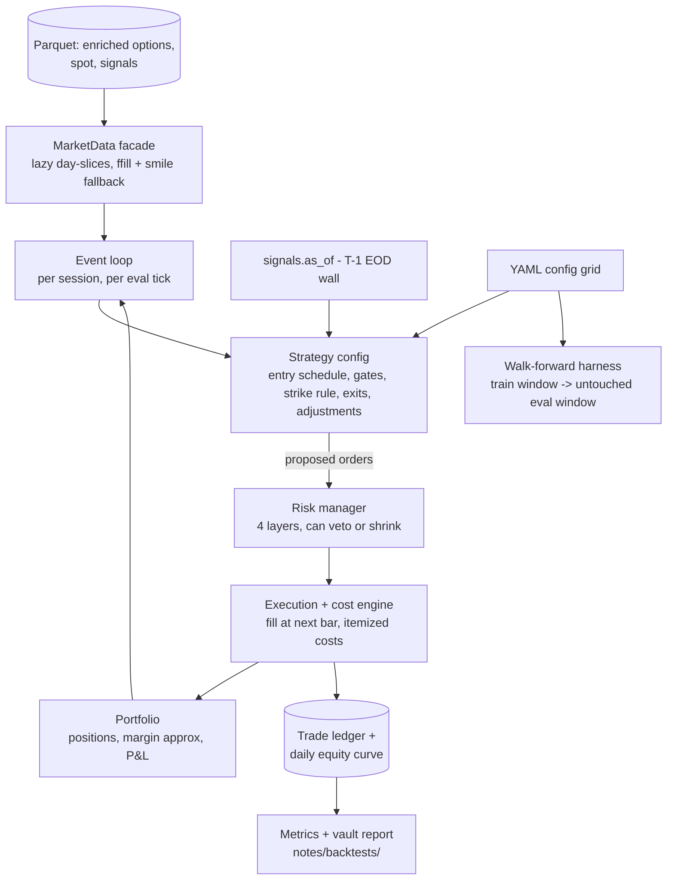

# Backtester Architecture (roadmap step 4 — design spec)

Part of [[Home]]. Consumes [[data-pipeline]] + [[vol-metrics]]; enforces [[risk-framework]]; implements [[vrp-signals]] exits and [[adjustment-policy]]. First candidates: weekly v0.1 ([[analysis-monday-entry]]) and the monthly vega variant (front-of-month, exit by 5–10 DTE — see 2026-07-18 discussion in [[decisions-log]]).

## Why event-driven

Adjustments, stops, and profit targets make P&L **path-dependent** — "did the stop fire before the target?" has no vectorized answer. The core is a chronological minute-bar event loop; everything else hangs off it.



## Components

1. **MarketData facade** — sole owner of Parquet access. Minute quotes with forward-fill (staleness cap) and smile-interpolated Black-76 fallback for far-OTM wing gaps; delta-targeted strike lookup; expiry calendar.
2. **Anti-look-ahead wall** (structural, not disciplinary): `signals.as_of(d)` exposes only T−1 15:15 rows (+ same-morning 09:20 IV); `_EVAL` columns unreachable from strategy code. **Decide on bar t, fill at bar t+1.**
3. **Structure model** — `Leg`, `Structure` (iron condor / iron fly only; max structural loss computed at construction). Naked shorts are unrepresentable by design.
4. **Strategy = config, not code** — entry schedule (DTE, time), gates (vrp_z, iv_rank, event multiplier), strike rule (short delta target, asymmetric wings per [[analysis-weekend-gaps]]), exits (profit %, stop multiple, delta breach, hard time), adjustment policy (v1: none | roll-untested). Variants are YAML files; H1/H2 are grid runs.
5. **Execution + cost engine** — every fill returns itemized costs (brokerage ₹20, STT 0.1% sell premium, exchange, GST, stamp, slippage = half-spread by moneyness). Costs attach to fills → adjustment frequency bleeds automatically; report checks the ~20%-of-gross sanity band.
6. **Portfolio + risk manager** — margin approximation (max-loss based; calibrate vs Dhan margin API before live). Layers in order: per-structure stop → weekly 4% → monthly 5% CB **with forced downsizing** → entry-time structural bound (−9% Monday ≤ 8% capital). Risk can veto/shrink entries; strategy cannot override.
7. **Event loop** — per session: load slice → eval ticks (configurable: every-minute vs 09:45/15:15 — that *is* H2) → mark → exits/adjustments → risk → entries. Appends to trade ledger + equity curve.
8. **Reporting + runner** — per run: config hash, ledgers, metrics (CAGR, Sharpe, maxDD, win rate, cost share, tail table) → meta.duckdb + auto-generated note in `notes/backtests/`. Walk-forward harness on top (select on train window, evaluate on untouched forward window).

## Engine test plan (before trusting any result)

- **Golden-week replays:** one calm week + one crash week (Apr 2025) hand-computed, asserted to the rupee.
- **Invariants on every run:** Δequity ≡ Σfills − Σcosts; loss per structure ≤ its structural max; no signal timestamp ≥ its use timestamp.

## Module layout

```
src/backtest/
  data.py         MarketData facade
  structures.py   Leg, Structure, valuation, structure greeks
  costs.py        cost model (single source of truth)
  strategy.py     config schema + entry/exit/adjustment evaluation
  risk.py         four-layer risk manager
  engine.py       event loop
  metrics.py      performance + tail metrics
  runner.py       config grid + walk-forward
configs/          YAML strategy variants (weekly_v01.yaml, monthly_vega.yaml, …)
scripts/run_backtest.py
```
